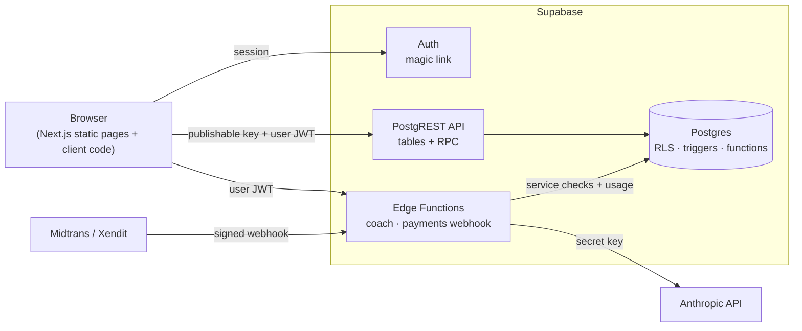

# Financial OS — Scaling Plan

Status: proposal for review · Date: 15 Nov 2026 · Scope: web app in `web/`, Supabase project already provisioned

## 1. Summary

Financial OS will run without a server of its own. The browser talks to Supabase directly, and Supabase carries three responsibilities:

| Responsibility | Where it lives |
|---|---|
| Who can see which rows | Postgres row-level security (RLS) |
| Rules the user must not bypass (limits, balances, XP) | Postgres constraints, triggers and functions |
| Anything that needs a secret (AI key, payment webhooks) | Supabase Edge Functions |

The Vercel deployment becomes static pages plus browser code. The current `/api/*` routes are retired as their work moves into Supabase.

The browser-storage "local mode" is removed. When Supabase is not configured, the app shows a "Layanan belum dikonfigurasi" screen instead of working on fake data.

## 2. Where we are today

Checked against the live database (Postgres 17) and the code on `main`:

- **Tables (6), all with RLS:** `user_profiles`, `financial_profiles`, `categories`, `transactions`, `financial_goals`, `goal_contributions`. Amounts are whole rupiah in `bigint`.
- **Policies:** select, insert, update and delete per table, limited to `auth.uid()`. `goal_contributions` has no update policy on purpose: a deposit is corrected by deleting and re-adding it.
- **Functions and triggers:** `set_updated_at`, `sync_goal_amount` (recomputes a goal's balance on every contribution), `seed_default_categories`.
- **Indexes:** `transactions_user_date_idx`, `transactions_category_idx`, `financial_goals_user_idx`, `goal_contributions_user_idx`, `goal_contributions_goal_idx`, `categories_user_idx`.
- **Users:** 0.

What will not scale in the current code:

| Problem | Where | Effect as data grows |
|---|---|---|
| Every transaction and contribution is loaded at once | `src/lib/store/supabase.ts` → `load()` | Payload and memory grow without limit; a user with 3 years of daily entries downloads thousands of rows on every visit |
| Totals, chart, donut and day groups computed in the browser | `src/lib/finance.ts`, `beranda/page.tsx`, `transaksi/page.tsx` | Slow on low-end Android phones, our main audience |
| Every write reloads everything | `refresh()` in `src/components/app-provider.tsx` | One saved transaction re-downloads the whole history |
| AI rate limit kept in server memory | `src/app/api/coach/route.ts` | Resets per Vercel instance, so it is not a real limit |
| Two code paths for every feature | `src/lib/store/local.ts` vs `supabase.ts` | Double maintenance; bugs that only exist in one mode |
| Migrations re-run by checking whether objects exist | `scripts/apply-migrations.mjs` | Unsafe once migrations start altering tables |

## 3. Target architecture

### Rules of the road

1. **The browser only ever holds the publishable key and the user's session.** The secret (service-role) key never leaves Supabase.
2. **RLS is the security boundary.** Every new table ships with RLS enabled and policies in the same migration. A table without policies is unreadable, which is the safe default.
3. **The browser may write directly only when no rule needs enforcing.** Adding or editing a transaction is a plain insert under RLS. Anything with a rule goes through a Postgres function:
   - goal deposits and withdrawals (cannot withdraw more than the balance)
   - creating a goal (free plan: one active goal)
   - anything that awards XP or counts toward a limit
4. **Functions that read run as the caller** (`security invoker`), so RLS applies automatically. Functions that must touch protected tables (usage counters, XP) run as `security definer`, take no user id as a parameter, and use `auth.uid()` inside.
5. **Edge Functions are the only place secrets exist.** They verify the user's JWT, check limits in the database, then call the outside service.

## 4. Data model

### 4.1 Existing tables (unchanged)
As listed in section 2.

### 4.2 New tables

All have `user_id uuid references auth.users on delete cascade`, RLS on, and owner-only policies unless noted.

| Table | Purpose | Notes |
|---|---|---|
| `debts` | Debt planner (provider, outstanding, rate, due date, minimum payment) | Rate stored as basis points (`int`), never float |
| `assets` | Cash, savings, other assets for net worth | |
| `financial_scores` | One row per calculation: score, breakdown (`jsonb`), `calculated_at` | Written only by a function, read by the user |
| `monthly_summaries` | Pre-computed income, expense and per-category totals per user per month | Maintained by trigger; see 5.3 |
| `ai_conversations`, `ai_messages` | Coach history | Written only by the coach Edge Function |
| `user_streaks` | Current and longest streak, last activity date | Written only by functions |
| `user_xp` | Total XP and level | Written only by functions |
| `achievements` | Global catalogue (name, description, XP reward) | Readable by every signed-in user; no user writes |
| `user_achievements` | Unlocked achievements per user | Written only by functions |
| `subscriptions` | Plan (`free`/`pro`/`premium`), status, period, expiry | Users read their own row; only the payment webhook writes |
| `usage_counters` | Count per user, feature and day (`ai_chat`, `receipt_scan`, …) | Written only through `increment_usage()` |
| `schema_migrations` | Which migration files have run | Used by the migration script, not exposed to the API |

### 4.3 Sign-up trigger

One trigger on `auth.users` (insert) creates, in a single transaction:
- a `user_profiles` row
- the default categories (replaces the browser calling `seed_default_categories`)
- a `subscriptions` row on the `free` plan
- `user_xp` and `user_streaks` rows at zero

This guarantees every account is complete, whichever app or device signed it up.

## 5. Reading data at scale

### 5.1 Totals computed in the database
Browser calls these through `supabase.rpc(...)`. All are `security invoker`, `stable`, and filter on `auth.uid()`.

| Function | Returns | Replaces |
|---|---|---|
| `period_summary(p_from date, p_to date)` | income, expense, net, transaction count | `totals()` |
| `cashflow_series(p_from, p_to, p_bucket text)` | cumulative net per day / week / month | `cumulativeSeries()` |
| `category_breakdown(p_from, p_to, p_type text)` | amount and share per category | `categoryBreakdown()` |
| `recorded_balance()` | starting savings + all-time net | `recordedBalance()` |
| `dashboard(p_period text)` | the above for current and previous period in one call | the four separate calculations on Beranda |

`dashboard()` matters most: Beranda becomes **one request** returning a few hundred bytes, whatever the size of the history.

### 5.2 Paginated transaction list
- Keyset pagination ordered by `(transaction_date desc, created_at desc, id desc)`, 30 rows per page, "load more" on scroll.
- Search and type filters run in the query. For text search, add a `pg_trgm` index on `description` once search becomes slow (not before).
- Day totals for the visible days come from a small grouped query, not from the loaded rows.
- New index: `transactions (user_id, transaction_date desc, created_at desc, id desc)` replaces `transactions_user_date_idx`.

### 5.3 Pre-aggregation (phase 4, when needed)
`monthly_summaries` holds one row per user per month with totals and a `jsonb` per-category breakdown. A trigger on `transactions` adjusts the affected month on insert, update and delete. `dashboard()` then reads at most 24 summary rows for year views instead of scanning transactions.

When: once the slowest `dashboard()` call takes more than 150 ms at the 95th percentile, or any user passes about 20,000 transactions. Before that, the indexed queries in 5.1 are fast enough and simpler.

### 5.4 Writes without full reloads
After a write, the browser updates the item it changed in its local cache and re-fetches only `dashboard()` and the first list page. A small query-cache library (TanStack Query) handles caching, retries and stale data so we don't hand-roll it.

## 6. Rules, limits and abuse

### 6.1 Plan limits

| Feature | Free | Pro | Premium |
|---|---|---|---|
| Active goals | 1 | unlimited | unlimited |
| AI Coach messages per day | 5 | 50 | 200 |
| Active challenges | 1 | unlimited | unlimited |
| Receipt scans per day | 0 | 20 | 50 |

Limits live in a `plan_limits` table, not in code, so they can change without a deploy. They are enforced in two places only:
- **Postgres functions** for database actions (`create_goal()` checks active goals)
- **Edge Functions** for outside services (coach, receipt scan)

The browser reads the same table to show "2 dari 5 chat hari ini", but its copy is for display only.

### 6.2 Usage counters and rate limits
`increment_usage(p_feature text)` locks the user's row for today, checks it against the plan limit, increments it, and returns allowed / not allowed in one atomic step. This replaces the in-memory limiter and works however many Edge Function instances run.

Burst protection for auth (magic-link requests) uses Supabase Auth's built-in rate limits, tightened in project settings.

### 6.3 Money correctness
- Amounts are always integers (rupiah). No floats anywhere in the database or functions.
- Goal balances come only from `sync_goal_amount`; the browser cannot write `current_amount`. A column-level grant revokes update on it.
- Withdrawals larger than the balance are rejected inside the deposit function, not just in the form.

## 7. AI Coach as an Edge Function

Flow for one message:
1. Browser sends the message with the user's JWT to the `coach` Edge Function.
2. The function verifies the JWT and calls `increment_usage('ai_chat')`. If over the limit, it returns a friendly "limit reached" response.
3. It calls `dashboard('month')` and a short goals summary **as the user** (RLS still applies), so the AI sees only that user's figures, and only as totals rather than raw rows.
4. It calls Anthropic with the secret key stored in Supabase secrets, and saves the user message and reply to `ai_messages`.
5. If Anthropic fails or no key is set, it returns the deterministic fallback reply already written in `src/lib`, labelled as such.

The Anthropic key moves from Vercel/`.env.local` to Supabase secrets.

## 8. Payments (later, design only)
- Subscription status is written **only** by a `payments-webhook` Edge Function that verifies the provider's signature (Midtrans or Xendit).
- The browser can start a checkout but can never mark itself as paid.
- Until a provider is configured, the pricing screen stays in its labelled simulation mode.

## 9. Capacity and cost

Rough figures for planning, assuming an average active user records 3 transactions a day.

| Stage | Users | Database size (approx.) | Supabase plan | Main limit to watch |
|---|---|---|---|---|
| Testing | < 100 | < 50 MB | Free | Built-in email sender: only a few auth emails per hour |
| Early launch | 1,000 | ~0.5 GB / year | Free → Pro | 500 MB free database cap; free projects pause after a week of inactivity |
| Growth | 10,000 | ~5 GB / year | Pro | Connection count from Edge Functions; add pre-aggregation (5.3) |
| Scale | 100,000+ | 50 GB+ / year | Pro + larger compute | Query performance; consider read replicas and partitioning `transactions` by month |

Before any real launch, regardless of size:
- **Move to Pro** (no pausing, daily backups, point-in-time recovery as an add-on).
- **Custom SMTP** (for example Resend or Postmark) for magic-link emails, with a sender on our own domain.
- **AI cost cap:** daily message limits per plan plus a monthly spend limit set in the Anthropic console.

## 10. Operations
- **Migrations:** one file per change in `web/supabase/migrations/`, tracked in `schema_migrations`, applied in order by `npm run db:migrate`. Never edit a migration that has run; add a new one.
- **Environments:** a second Supabase project for staging; production changes go through staging first.
- **Security check in CI:** `npm run db:check-rls` extended to every table and RPC, run against staging on every pull request.
- **Monitoring:** Supabase query performance report weekly; alert when slow queries or error rates rise. Edge Function logs exclude amounts and personal data.
- **Backups:** Pro plan daily backups; test a restore once before launch.
- **Data rights:** export (CSV of all user tables) and account deletion (cascades from `auth.users`) as database functions, required for Indonesia's data-protection law (UU PDP).

## 11. Rollout phases

| Phase | Work | Done when |
|---|---|---|
| **1. Direct and lean** | Remove local mode and its notice; config error screen; browser reads via `dashboard()` and paginated list; TanStack Query; new index; `schema_migrations` | Beranda is one request; no screen loads full history; local-mode code deleted |
| **2. Rules in the database** | New tables, sign-up trigger, `plan_limits`, `usage_counters`, `create_goal()` and deposit functions, column grants; retire `/api/transactions`, `/api/goals`, `/api/onboarding` | Free-plan goal limit enforced even with a hand-crafted request; RLS check covers all tables |
| **3. Coach on Edge Functions** | `coach` Edge Function, stored conversations, key in Supabase secrets; retire `/api/coach` | No `/api/*` routes left; key absent from Vercel |
| **4. Ready for growth** | `monthly_summaries`, staging project, CI security check, custom SMTP, Pro plan, load test with 10,000 transactions per user | Dashboard p95 < 150 ms at 10,000 transactions; restore tested |

Each phase is shippable on its own and leaves the app working.

## 12. Decisions still open
1. **Payment provider:** Midtrans or Xendit (affects only the webhook function).
2. **Data residency:** the Supabase project's region. Singapore is closest to Indonesia; confirm against UU PDP requirements before launch.
3. **Native mobile app:** if planned, it reuses this exact model (Supabase client + RLS + Edge Functions) with no server changes.
4. **Exact plan prices and limits:** section 6.1 uses placeholders; they live in `plan_limits` and can change without code.
